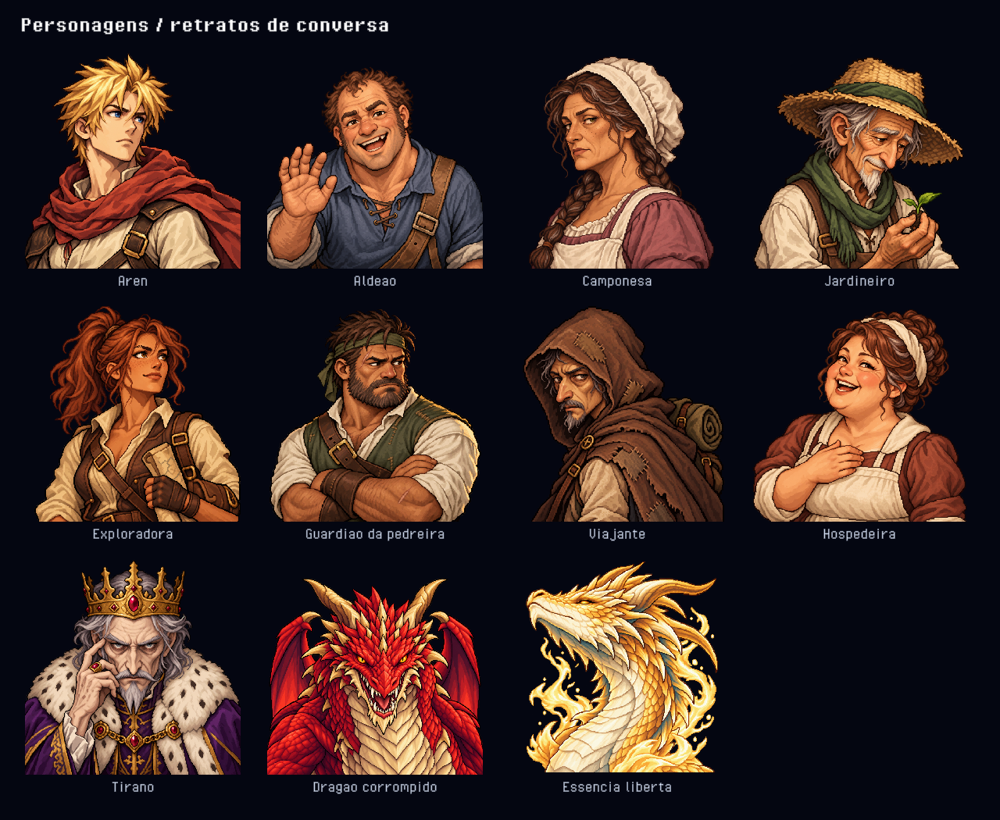
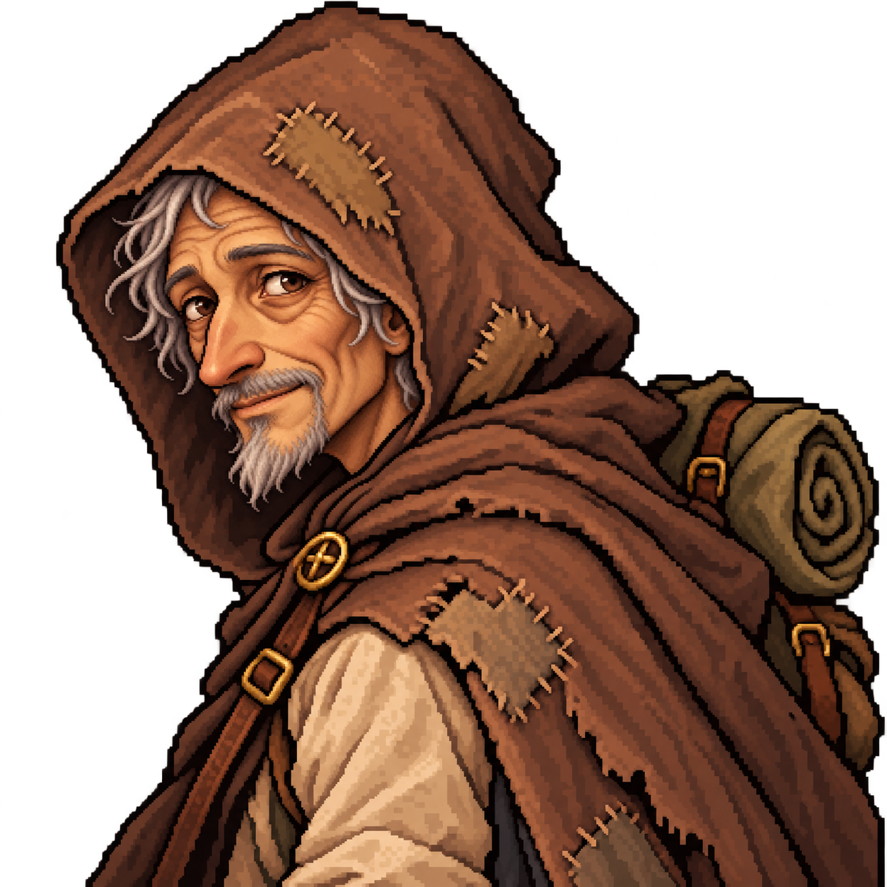

> Referência de autoria e produção; pode registrar uma versão visual substituída. O funcionamento vigente está em [Docs/Current](../Current/README.md).

# Retratos de conversa

Doze ilustrações originais em pixel art, com fisionomia, idade, expressão, silhueta e pose próprias. A aparência dos personagens conserva os trajes e cabelos dos sprites do jogo, com anatomia mais natural.

| Personagem | Direção de personagem e pose | PNG em `Assets/Resources/PixelArt/DialoguePortraits` |
| --- | --- | --- |
| Aren / narrador | Jovem de rosto triangular e olhar determinado, cabeça virada à esquerda e capa diagonal | `aren.png` |
| Aldeão | Robusto, rosto redondo e nariz largo; sorriso aberto e mão acenando | `villager.png` |
| Camponesa | Mulher mais velha, rosto quadrado e olhar perspicaz; cabeça de lado e expressão reservada | `peasant.png` |
| Jardineiro | Idoso magro, rosto comprido e rugas marcadas; curvado sobre uma muda | `gardener.png` |
| Exploradora | Rosto anguloso, pele bronzeada e sardas; queixo erguido, meio sorriso e mapa sob o braço | `explorer.png` |
| Guardião da pedreira | Mandíbula larga, nariz achatado e barba curta; braços cruzados e olhar desconfiado | `quarry-keeper.png` |
| Viajante | Senhor magrinho e gentil, cabelos grisalhos, sorriso discreto e olhar esperançoso; capuz remendado e mochila | `traveler.png` |
| Hospedeira | Rosto cheio, bochechas rosadas e coque; gargalhada acolhedora com a mão sobre o avental | `innkeeper.png` |
| Guarda Real | Rosto maduro de mandíbula quadrada, barba curta e ordem severa; cabeça à esquerda, elmo prateado e penacho vermelho | `guard.png` |
| Rei Rubro | Rei envelhecido de rosto ósseo e nariz adunco; olhar frontal severo e mão com anel junto ao rosto | `tyrant.png` |
| Dragão corrompido | Cabeça frontal larga e baixa, olhar furioso e presas expostas | `dragon.png` |
| Essência liberta | Perfil dourado à esquerda, pescoço em curva e cabeça elevada em serenidade | `dragon-essence.png` |

Produção em 16 de outubro de 2026 com o `image_gen` integrado, uma geração por personagem. `NpcRoster`, `ArenWalk` e `Dragon` servem somente como referência de identidade e traje. Cada rosto é descrito independentemente, incluindo estrutura óssea, idade, assimetria, temperamento e pose. Os PNGs são copiados integralmente, preservando a transparência, sem edição posterior. Os sprites do cenário permanecem com seus arquivos existentes.

O campo azul tem altura fixa de 180 unidades na referência de 720 de altura, independente do tamanho da fala ou do número de opções. A fala aparece gradualmente e rola em linhas inteiras, enquanto o nome fica fixo no topo. O retrato transparente não tem fundo ou borda próprios e sua base fica 8 unidades acima do fundo do painel, liberando a moldura inferior. À esquerda, a imagem encosta no limite interno da moldura, com recuo de 8 unidades em relação à borda externa. O deslocamento preserva o tamanho e se soma à sobreposição de 20% em telas largas. Em formatos estreitos, a imagem diminui para reservar espaço ao texto, mantendo as proporções. Nome, fala e escolhas ficam à direita. Detalhes e prévias do comportamento: [DIALOGUE_PRESENTATION.md](../History/Features/DIALOGUE_PRESENTATION.md).

A importação usa Point/Clamp, sem mipmaps, compressão, alteração de dimensões ou cópia legível em CPU. `DialoguePortraitCatalog` resolve os personagens e `DialoguePresentation` guarda os retratos carregados durante a sessão.

Prompts completos, referências e hashes de cada original: [ArtInputs/DialoguePortraits/prompts.json](ArtInputs/DialoguePortraits/prompts.json).

`Tools > Dragon Quest > Validate Dialogue Portraits` confere os doze recursos, transparência, resolução nativa, importação, altura fixa e alinhamento inferior em três formatos de tela, além do avanço da escrita, escolhas e callbacks. As prévias são renderizadas em um projeto Unity isolado da sessão de jogo do usuário.

Validação concluída: scripts compilados com a Unity 6000.6.5f1; 169 verificações de páginas, escolhas, cancelamento e escrita; conferência nativa dos onze PNGs e de 17.297.676 pixels originais; 60 capturas do painel compacto em 1280 × 720, 960 × 720 e 540 × 960, incluindo escrita e rolagem de fala longa, fala curta e opções. A comparação visual confirmou a altura constante, o retrato transparente alinhado ao fundo e a separação da coluna de texto. A galeria acima registra a coleção original de 16 de outubro, antes da revisão do viajante abaixo.

## Viajante gentil — 17 de outubro de 2026

O viajante da floresta passou a ser um senhor magrinho, gentil e esperançoso, com sorriso discreto, olhar acolhedor e cabelos e barba grisalhos. A edição com o `image_gen` integrado preserva o estilo em pixel art, a pose, o capuz marrom remendado, a mochila e a paleta do retrato anterior. O PNG gerado foi copiado integralmente em 1254 × 1254, com transparência real, sem alterar o GUID ou o importador. O prompt completo e o SHA-256 atualizado estão no manifesto de arte.

Validação desta revisão: importação e carregamento do recurso confirmados na Unity 6000.6.5f1 em projeto isolado; resolução nativa de 1254 × 1254, GUID preservado, alpha real e Point/Clamp sem mipmaps, compressão ou redimensionamento. Os hashes e as configurações dos onze retratos também foram conferidos.

## Guarda Real — 20 de outubro de 2026

A advertência dos guardas da ponte usa `guard.png`, um retrato próprio de guarda, em vez do fallback do Aren. O novo personagem conserva o elmo prateado, o penacho vermelho e a armadura de `GuardBattle.png`, com fisionomia madura, barba curta e expressão severa. O retrato do Aren serviu apenas como referência de acabamento; rosto, expressão e pose são distintos, conferidos lado a lado com a coleção.

Gerado com o `image_gen` integrado e copiado integralmente em 1254 × 1254, com alpha real e importação Point/Clamp, sem compressão, mipmaps ou redimensionamento. Prompt, referências e hash: [ArtInputs/DialoguePortraits/guard.prompt.json](ArtInputs/DialoguePortraits/guard.prompt.json). A compilação dos scripts com as bibliotecas da Unity e a conferência dos doze PNGs e das configurações do novo importador passaram. Esta revisão não incluiu execução em Play.
