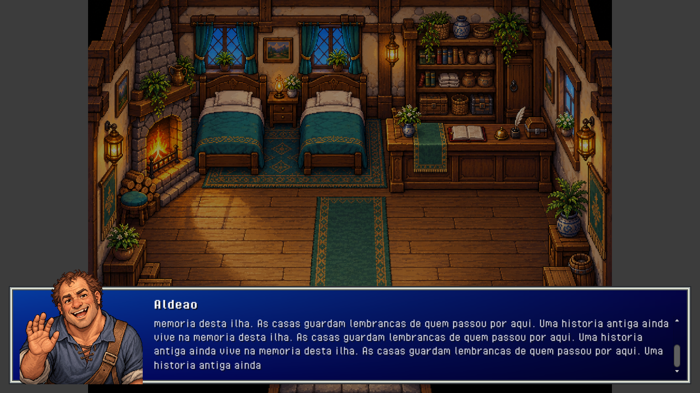

# Conversas com retrato

Todos os diálogos abertos por `DialogueController` usam `DialoguePresentation`: retrato à esquerda, nome no alto da coluna direita e fala abaixo do nome. O fundo tem o mesmo degradê azul e a mesma moldura prateada da seleção de Load / New game. A interface exibe somente retrato, nome, fala e opções de resposta.

Os onze retratos são ilustrações próprias em pixel art, com fisionomias, idades, expressões e poses distintas, em `Resources/PixelArt/DialoguePortraits`. Preservam cabelos, roupas e identidade dos sprites, sem usar recortes dos personagens de caminhada. O dragão corrompido e sua essência têm artes distintas. Mensagens narrativas, objetos e a consulta do poema usam o retrato ilustrado de Aren. `DialoguePortraitCatalog` associa os nomes aos PNGs; a interface desenha cada imagem inteira com proporção preservada. Coleção e prompts: [DIALOGUE_PORTRAITS.md](DIALOGUE_PORTRAITS.md).

A altura é fixa em 180 unidades na referência de 720, cerca de 34% menor que antes, e não depende da fala nem das escolhas. O nome permanece no topo da coluna direita. A fala aparece gradualmente a 48 caracteres por segundo e rola em linhas inteiras para acompanhar o trecho escrito, sem ampliar a caixa. Depois da escrita, a rolagem manual permite reler o conteúdo. Cada nova página retorna ao início, mesmo quando repete o mesmo texto.

E, Espaço ou Enter completa a fala em andamento; uma nova pressão avança para a próxima página. As respostas aparecem ao terminar a fala como linhas de texto, sem fundo, contorno ou numeração. A mesma mãozinha dos outros menus indica a opção selecionada: ↑/↓ navega, com retorno entre a primeira e a última opção, e Enter, Espaço ou E confirma. A rolagem acompanha a seleção para manter a mãozinha visível. Clique e atalhos 1/2/3 continuam disponíveis; mover o mouse seleciona uma linha, sem interferir nas setas quando o ponteiro está parado. Esc cancela a conversa. A escrita preserva letras com acentos combinantes e pares de caracteres Unicode.

O retrato não tem fundo nem borda próprios e sua base fica 8 unidades acima do fundo do painel, liberando a moldura inferior. À esquerda, a imagem encosta no limite interno da moldura, com recuo de 8 unidades em relação à borda externa. Esse deslocamento sobe a imagem inteira, preservando o tamanho e as proporções. Em telas largas, soma-se à sobreposição de 20%; em formatos estreitos, o retrato diminui para reservar espaço ao texto. Páginas e callbacks de batalha/salvamento conservam o fluxo existente.

O alvo de interação é procurado somente ao pressionar E, preservando alcance e bloqueio por menus. `PrototypeHud` desenha a interface apenas enquanto uma conversa estiver aberta.

Validação: scripts compilados com as bibliotecas da Unity 6000.6.5f1; as 169 verificações de `Tools/Test-Secrets.ps1`, incluindo páginas, escolhas, cancelamento e escrita gradual, passaram.

Foram geradas 60 capturas nativas de IMGUI em projeto temporário isolado, em 1280 × 720, 960 × 720 e 540 × 960. Incluem os onze retratos, fala curta, fases de escrita de uma fala longa, respostas antes/depois da escrita, releitura manual e reabertura de texto idêntico. A validação nativa confirmou a altura fixa de 180, os retratos alinhados pela base, a rolagem avançando durante a escrita, a rolagem manual preservada após o término e o retorno ao início em outra página. A conferência visual verificou o nome fixo e a separação entre texto e retrato. A escala DPI e a orientação da captura foram compensadas. As prévias verificam a interface em uma sessão isolada.

