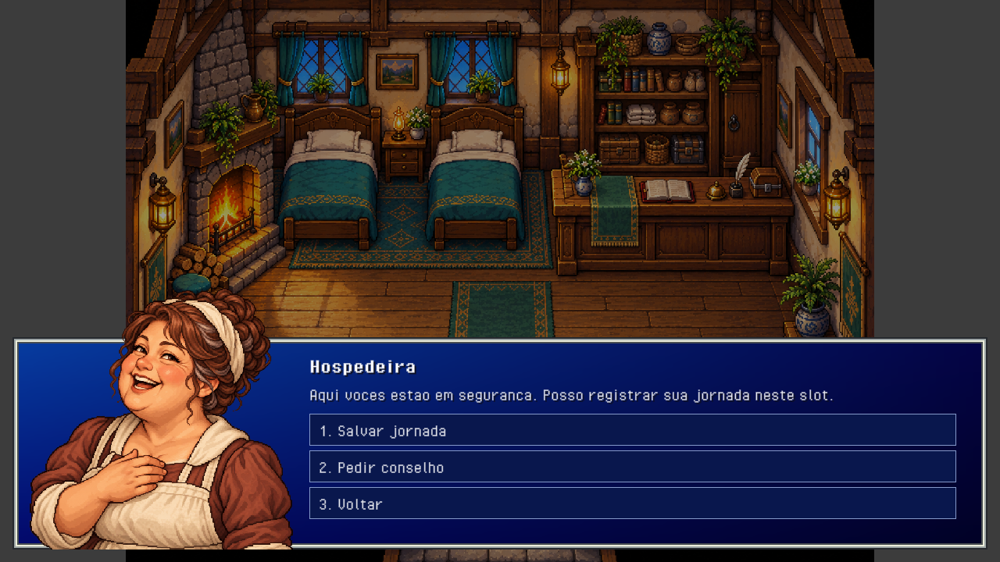

# Conversas com retrato

Todos os diálogos abertos por `DialogueController` usam `DialoguePresentation`: retrato à esquerda, nome no alto da coluna direita e fala abaixo do nome. O fundo tem o mesmo degradê azul e a mesma moldura prateada da seleção de Load / New game. A interface exibe somente retrato, nome, fala e opções de resposta; não há instruções de teclas, contador de páginas nem box de interação.

Os onze retratos são ilustrações próprias em pixel art, com fisionomias, idades, expressões e poses distintas, em `Resources/PixelArt/DialoguePortraits`. Preservam cabelos, roupas e identidade dos sprites, sem usar recortes dos personagens de caminhada. O dragão corrompido e sua essência têm artes distintas. Mensagens narrativas, objetos e a consulta do poema usam o retrato ilustrado de Aren. `DialoguePortraitCatalog` associa os nomes aos PNGs; a interface desenha cada imagem inteira com proporção preservada. Coleção e prompts: [DIALOGUE_PORTRAITS.md](DIALOGUE_PORTRAITS.md).

A altura é fixa em 272 unidades na referência de 720 e não depende da fala nem das escolhas. O conteúdo excedente usa rolagem dentro da coluna direita. A troca de fala retorna ao início. O retrato não tem fundo nem borda próprios: sobrepõe o painel com 20% da altura da sua área acima do topo da caixa. Páginas, escolhas pelo teclado ou clique, cancelamento e callbacks de batalha/salvamento mantêm o fluxo existente.

O box de proximidade, seus textos e a propriedade `Prompt` foram removidos. O alvo de interação é procurado somente ao pressionar E, preservando alcance, bloqueio por menus e execução da interação.

Validação: scripts compilados com as bibliotecas da Unity 6000.6.5f1; as 159 verificações de `Tools/Test-Secrets.ps1`, incluindo páginas, escolhas e cancelamento, passaram.

Foram geradas 39 capturas nativas de IMGUI em projeto temporário isolado: os onze retratos, a hospedeira com três opções e falas curta e longa da camponesa, em 1280 × 720, 960 × 720 e 540 × 960. A conferência visual verificou a posição dos retratos, o nome acima da fala, a quebra de linha, a separação entre texto e retrato, a altura fixa e a sobreposição sem moldura e a remoção das ajudas abaixo das falas. A escala DPI e a orientação da superfície de captura foram compensadas na leitura das imagens. Essas prévias verificam a interface; não são capturas da sessão de jogo aberta do usuário.

