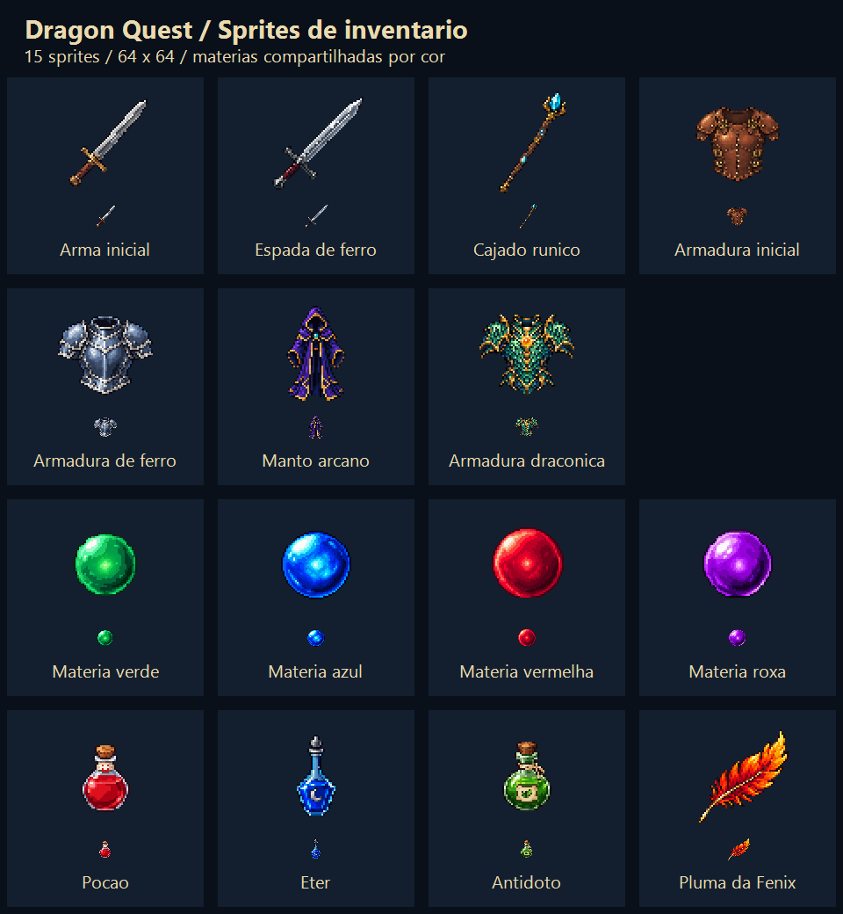

# Sprites de equipamentos, materias e itens

15 sprites PNG RGBA de 64 x 64 pixels, em `Assets/Resources/PixelArt/Inventory/`.
Gerados com a ferramenta integrada `image_gen`, um objeto por chamada. Os prompts completos
e as referencias dos arquivos originais estao em `ArtInputs/InventorySprites.prompt.json`.
Exportacao para 64 x 64 por nearest-neighbor, preservando o canal alpha da geracao.

| Categoria | Arquivos |
| --- | --- |
| Armas | `initial-weapon`, `iron-sword`, `runic-staff` |
| Armaduras | `initial-armor`, `iron-armor`, `arcane-robe`, `dragon-armor` |
| Materias | `materia-green`, `materia-blue`, `materia-red`, `materia-purple` |
| Consumiveis | `potion`, `ether`, `antidote`, `phoenix-feather` |

As 19 definicoes de materia usam apenas quatro sprites: verde para magia, azul para suporte,
vermelho para invocacao e roxo para aprimoramento fisico. A Escama ancestral conserva a arte existente.

`InventoryIconCatalog` resolve equipamentos pela definicao, consumiveis pelo ID e materias pelo tipo.
`InventoryPixelArt` carrega e compartilha as texturas de Resources. Os PNGs tambem sao importados
como Sprite Single, com pivot central, 64 pixels por unidade, Point, sem mipmaps e sem compressao.

Integracao: listas e encaixes de materias; equipamento atual, lista e comparacao;
inventario de consumiveis; compra e venda, incluindo detalhe do objeto; lista de itens em batalha.
Nomes, quantidades e cores continuam visiveis junto dos sprites.

Validacao: compilar todos os scripts com `Tools/Test-UnityScripts.ps1` e executar
`InventorySpriteValidation.Run` na Unity, ou pelo menu `Tools > Dragon Quest > Validate Inventory Sprites`.
O validador confere as 30 definicoes existentes, compartilhamento por cor, os 15 Sprite Single,
dimensoes, margens transparentes, filtragem e importacao sem compressao.

Validado: compilacao de todos os scripts do projeto com as bibliotecas da Unity 6000.6.5f1;
importacao dos PNGs e execucao de `InventorySpriteValidation.Run` em um projeto temporario
com os mesmos arquivos e catalogos, com codigo de saida 0. A copia temporaria permite validar
sem fechar o projeto aberto no Editor.
