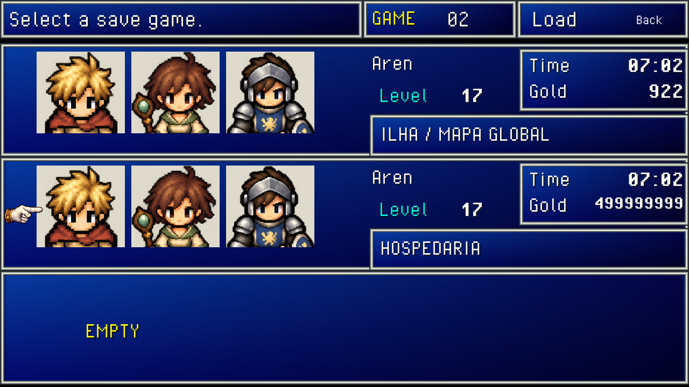

# Seleção dos três saves

A seleção de Load e New game usa três painéis azuis com moldura prateada, retratos de Aren/Lia/Bram, nome e nível do líder, Time, Gold e localização. O recorte dos retratos usa a parte superior dos sprites existentes de caminhada, sem alterar as imagens originais. A maozinha marca a linha inteira; clique, setas/W/S e Enter/Espaço escolhem o slot. Back e Esc retornam à tela inicial. Slots vazios mostram EMPTY e continuam indisponíveis para Load; saves inválidos mostram UNAVAILABLE. A confirmação de substituição permanece em New game.

O campo opcional `JourneyData.PlaySeconds` grava o tempo de jogo em segundos. O contador avança durante a sessão com o jogo em foco, incluindo diálogos, inventário e batalhas; abertura, tela inicial, seleção de saves e finais não contam. Carregar retoma o tempo salvo e New game reinicia em zero. Saves antigos mantêm o formato/versão e exibem `--:--`, pois não registravam duração; o próximo salvamento passa a registrar o tempo acompanhado desde o carregamento. O campo não habilita salvamento automático.

`Tools/Test-Saves.ps1` verifica o campo no serializador, zero segundos, compatibilidade com arquivos sem o campo e rejeição de duração negativa. A compilação completa continua em `Tools/Test-UnityScripts.ps1`.
